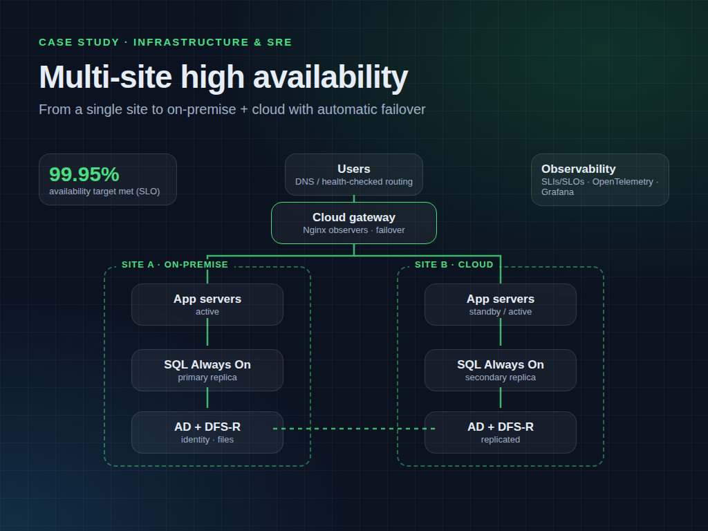
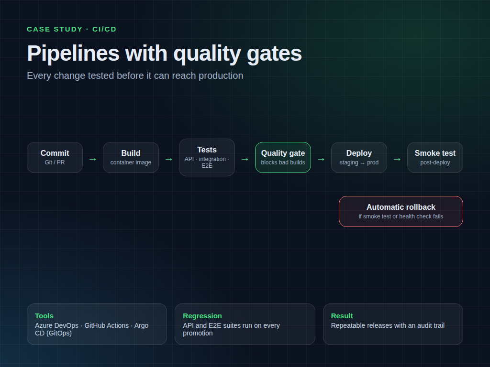
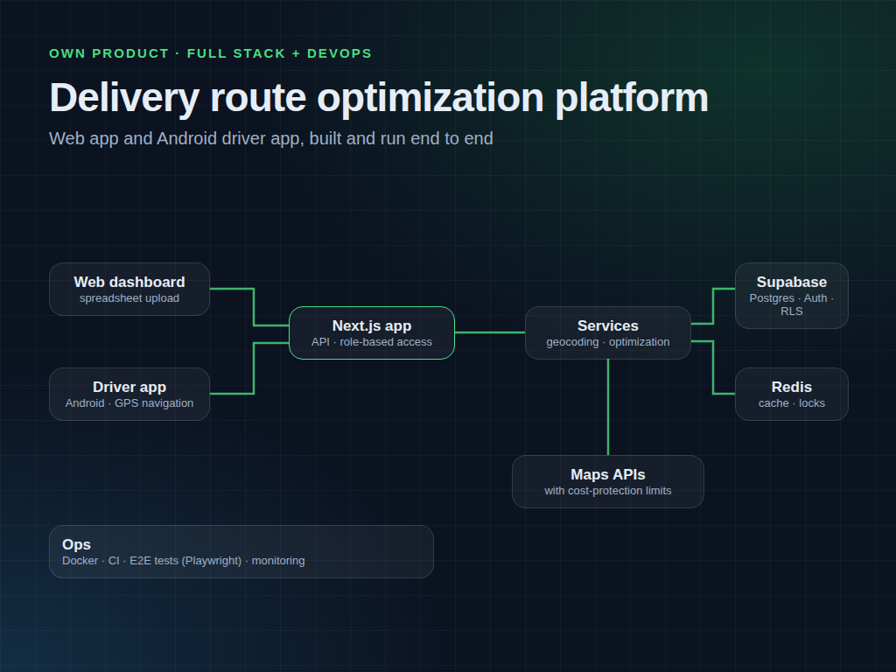
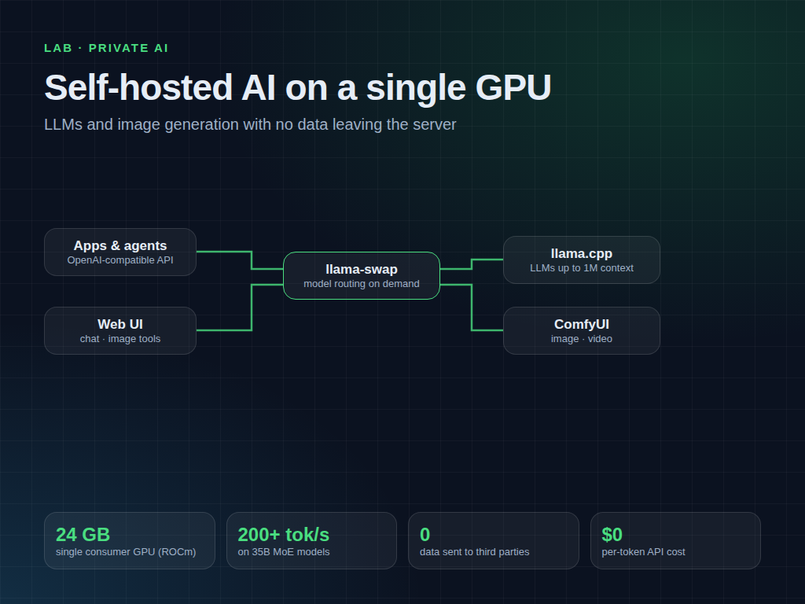

# Renan Silva · DevOps & SRE portfolio

DevOps and SRE engineer with 20+ years in IT. I put applications online and keep them running:
Linux and Windows servers, Docker and Kubernetes, CI/CD, VPN, monitoring, backups and
high availability, on-premise or in the cloud (AWS, Azure, any VPS).

This repository shows how I work. Client names, internal data and proprietary code are
intentionally left out; the case studies describe architecture and results only.

---

## Case studies

### Multi-site high availability (99.95% SLO)

- Moved a centralized environment to a distributed architecture across an on-premise site and the cloud.
- Cloud gateway with Nginx "observers" redirecting traffic for transparent failover.
- Replicated critical services: SQL Server Always On, Active Directory multi-site and DFS-R file servers.
- Defined SLIs and SLOs, health checks and observability (OpenTelemetry, Grafana, Dynatrace) to track availability, latency and error budget.

### CI/CD with quality gates

- Pipelines built from scratch in Azure DevOps, plus GitOps with Argo CD.
- API, integration, E2E and regression tests on every promotion; quality gates block versions that fail.
- Post-deploy smoke tests with automatic rollback; infrastructure as code (Terraform, Ansible).

### Delivery route optimization platform (own product)

- Web dashboard plus Android driver app with turn-by-turn GPS navigation, designed, built and operated end to end.
- Next.js, Supabase (Postgres, Auth, row-level security), Redis for caching and locks, external maps APIs behind cost-protection limits.
- Dockerized deploy, CI, Playwright end-to-end tests and monitoring.

### Self-hosted AI on a single GPU

- Private LLM and image-generation stack on one 24 GB consumer GPU (ROCm): llama.cpp behind llama-swap (on-demand model routing, OpenAI-compatible API) and ComfyUI.
- 35B mixture-of-experts models above 200 tokens/s, contexts up to 1M tokens.
- No data leaves the server and there is no per-token API cost.

---

## Templates

| Template | What it gives you |
|---|---|
| [production-deploy](templates/production-deploy) | App in Docker + PostgreSQL + Nginx with free HTTPS, auto-renewing certificates, daily backups with retention, server hardening, CI/CD from GitHub and optional Prometheus/Grafana monitoring |

---

## Skills

**Cloud & containers:** AWS, Azure, Docker, Kubernetes, VMware ESXi ·
**Automation & CI/CD:** Terraform, Ansible, Argo CD, Azure DevOps, GitHub Actions, PowerShell, Python, Bash ·
**Observability:** Prometheus, Grafana, Zabbix, Dynatrace, OpenTelemetry ·
**Security:** Wazuh, SonarQube, Entra ID / Active Directory, WAF, hardening ·
**Networking:** Linux, Windows Server, Nginx, Traefik, Envoy, pfSense, WireGuard, OpenVPN, DNS

**Certification:** Microsoft Certified: Windows Server Hybrid Administrator Associate ·
**Education:** postgraduate degrees in Cybersecurity, Cloud Computing and Systems Architecture

## How I work

Clear scope in writing before starting, fixed price, changes to production only with approval
and a rollback plan, and full documentation on delivery. I work async in writing, so every
step is recorded.

---

Templates are released under the [MIT License](LICENSE). Images and case-study texts © Renan Silva.
